<h1 align="center">zajel.</h1>

<p align="center"><strong>Your mail, calendar and contacts in one fast, self-hosted workspace, with an AI agent that works for you and never behind your back.</strong></p>

<p align="center"><sub>Formerly ameera.</sub></p>

<p align="center">
  <a href="https://github.com/odaiameera/zajel-mail/actions/workflows/ci.yml"></a>
  <a href="LICENSE"></a>
  
  
</p>

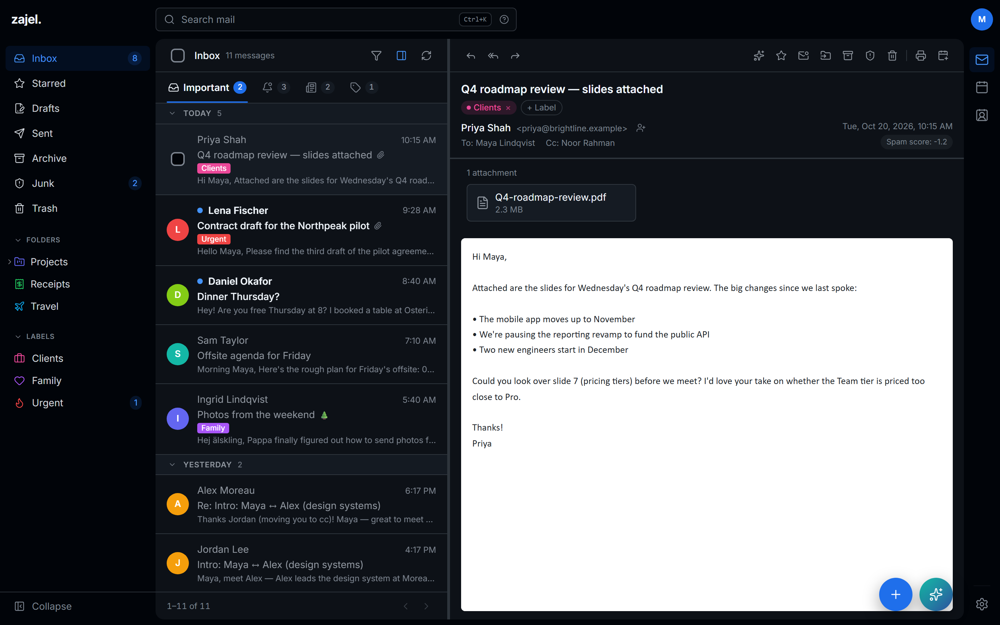

Zajel Mail is one SvelteKit application that speaks **JMAP** for mail and contacts and **CalDAV** for calendars. It sits in front of your own [Stalwart](https://stalw.art) server, so every part of the stack stays under your control, including the AI.

It's built to feel quick and calm:
- **Inbox tabs** keep mail you need apart from notices, newsletters and offers.
- A **composer** can send later, even after you close the tab.
- **Zajel**, the AI agent, reads your mailbox and calendar and tells you what needs you today.
- **Jev**, an optional decision model, sorts new mail and runs rules you write in plain English.

> Every screenshot in this README is the real app, running against a mock mail server filled with fictional people and companies.

---

## Contents

- [Why Zajel Mail](#why-zajel-mail)
- [Highlights](#highlights)
- [A tour](#a-tour)
  - [Mail](#mail)
  - [The composer](#the-composer)
  - [Zajel, the AI agent](#zajel-the-ai-agent)
  - [Jev: an Inbox that sorts itself](#jev-an-inbox-that-sorts-itself)
  - [Calendar](#calendar)
  - [Contacts](#contacts)
  - [Make it yours](#make-it-yours)
  - [On your phone](#on-your-phone)
- [Security and privacy](#security-and-privacy)
- [Installation](#installation)
  - [Quick start (development)](#quick-start-development)
  - [Docker (production)](#docker-production)
  - [Installing with Jev](#installing-with-jev)
  - [Setting up Zajel](#setting-up-zajel)
- [Configuration](#configuration)
- [Contributing](#contributing)
- [Roadmap](#roadmap)
- [License](#license)

---

## Why Zajel Mail

Most webmail gives you a good client with no intelligence, or an intelligent client that reads your mail on someone else's servers. Zajel Mail is the third option. Mail, calendar, contacts and an assistant share one interface and one trust boundary: yours.

Three principles shape it:

**Your server is the source of truth.** Mail, contacts and calendars live in Stalwart, over JMAP and CalDAV. The app keeps no shadow copy that drifts from the rest of your setup, so a change made in Apple Mail or a CardDAV client shows up here, and the other way round.

**The assistant proposes; you decide.** Zajel never sends a reply, creates a task or changes your calendar on its own. Drafts wait for your review. Calendar and task changes appear as confirmation cards that name exactly what will happen, and they apply only when you click. A proposed deletion shows the event's title and date, not an opaque id.

**Credentials stay on the server.** Mail passwords are encrypted at rest. AI, Jev and task-app tokens are read only in server-side modules and never reach the browser.

---

## Highlights

- 📬 **Several mail accounts under one sign-in.** Each account has its own colour, photo and unread badges.
- 🗂️ **Inbox tabs** (Important, Updates, Newsletters, Promotions). Sort by hand, by dragging, or with Jev.
- 🪶 **Zajel, the AI agent.** It searches your whole mailbox and calendar, summarises your day, drafts replies and proposes events and tasks. It runs on **OpenAI GPT-5.6** or on any **Ollama** model, including one on your own machine.
- 🧠 **Jev rules in plain English**, such as *"it's an invoice or a request for payment"*, with a strictness you choose and a test run on recent mail.
- ⏰ **Send later and Undo send, handled by the server.** A scheduled message goes out on time even with every tab closed.
- 🔑 **Sign-in codes detected**, with a one-click **Copy code** that can also send the email to Trash.
- 📅 **CalDAV calendars**: month, week, work week, 3-day and day views, invitations, reminders and keyboard shortcuts.
- 👥 **Contacts with lists**, plus vCard and CSV import from Apple and Google that previews every row before writing anything.
- 🎨 **Icons and colours for folders and labels**, picked from the full Lucide set of about 1,900 icons.
- 🌗 **Dark and light themes**, two densities and a reading pane you can turn off.
- 📱 **Built for phones too.** It installs as a PWA, with a bottom tab bar and drawers.
- 🔒 **Secure by default**: passkeys, scrypt-hashed master password, AES-256-GCM encrypted mail credentials, sandboxed message rendering and a remote-image proxy.

---

## A tour

### Mail

The inbox is built for getting through mail, not just reading it.

**Inbox tabs.** Messages split into **Important**, **Updates**, **Newsletters** and **Promotions**, each with its own unread count. A tab only changes where you see a message; it stays in your Inbox on the server. You can sort mail yourself:
- drag a message onto a tab, or
- use **Move to tab**.

**Folders and labels.** Folders are real JMAP mailboxes and can nest. Labels are mailboxes too, grouped under a `Labels` parent, so they show up cleanly in any other client. Both can have a colour and an icon.

**Search** sits at the top of every page (<kbd>Ctrl</kbd>/<kbd>⌘</kbd>+<kbd>K</kbd>, or <kbd>/</kbd>). It looks across every folder, and active filters show as chips you can clear.

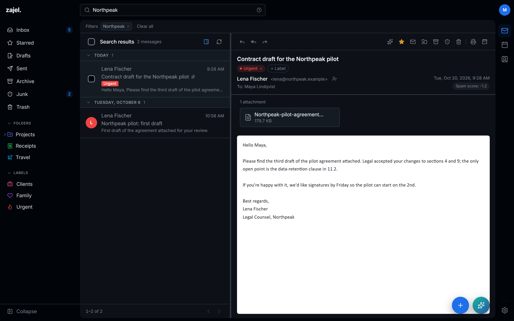

**Reading mail**
- Conversations are threaded.
- The reading pane can be toggled, and it stays put when a filter has no results.
- Attachments show as cards. Inline `cid:` images render.
- Remote images load through a **server-side proxy**, so the sender's image host sees your server's address, not yours. You can choose to never load them, load them for contacts only, or always.
- **Sender trust** comes from your address book and the message's authentication results. Stalwart's spam score sits beside every message, and flagged mail says why it was flagged.
- **One-click unsubscribe** appears for mailing lists that support it.
- **Add to calendar** turns an email about a dinner or a meeting into an event.
- **Print** a clean copy of any message.

**Sign-in codes are found for you.** The code appears above the message with a **Copy code** button, which can also move the email to Trash once you've used it.

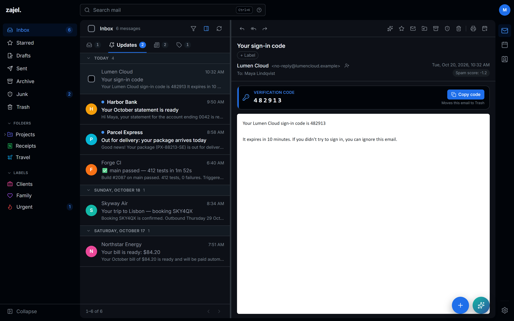

**Staying on top of things**
- **Remind Me Later** snoozes a message until later today, tomorrow morning or evening, this weekend or next week.
- **Starred** keeps the mail you flagged in one place.
- **Archive** works even when your server has no folder with the archive role: it uses your top-level `Archive` folder.
- **Trash can empty itself** after 7 or 30 days.
- **Rules** run on the server about a minute after mail lands, and are deployed as Sieve too, so they keep filtering with every tab closed. A live count shows how many existing emails a rule matches, and **Save & apply** sorts them right away.
- **Auto-reply** is deployed to your mail server as a Sieve vacation message, with a subject and body you choose.
- **Sender avatars** come from BIMI, site favicons and Gravatar. They're cached on the server, so every device shares one lookup. Lookups that find nothing are remembered too, instead of being retried on every render.

### The composer

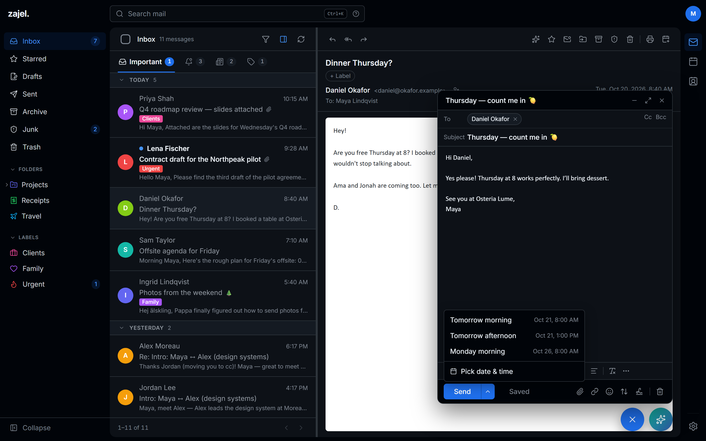

The composer opens in the bottom-right corner above the **+** button. It stays out of the way while you read the message you're replying to.

- **Rich text** formatting:
  - bold, italic, underline and strikethrough
  - text colour and highlight
  - bulleted and numbered lists, quotes and alignment
  - links and an emoji picker
- **Recipients** become chips as you type, with autocomplete over the people you've emailed. Cc and Bcc are one click away.
- **Attachments**, **importance** and **signatures** for each identity sit in the footer.
- **Send later.** Pick tomorrow morning, tomorrow afternoon or Monday morning, or choose any date and time. The **server** sends the message, so it goes out on time even if you close every tab.
- **Undo send.** You get 5 to 30 seconds to change your mind after pressing Send.
- **Drafts save automatically**, on an interval you choose. Closing a message that has anything in it saves it as a draft.
- **Minimize** and **full screen** are in the title bar. The default font and size are your choice.

The **+** button is one place to start anything: a message, an event or a contact, from any page.

<p align="center">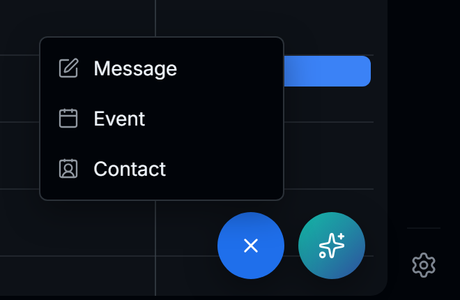</p>

### Zajel, the AI agent

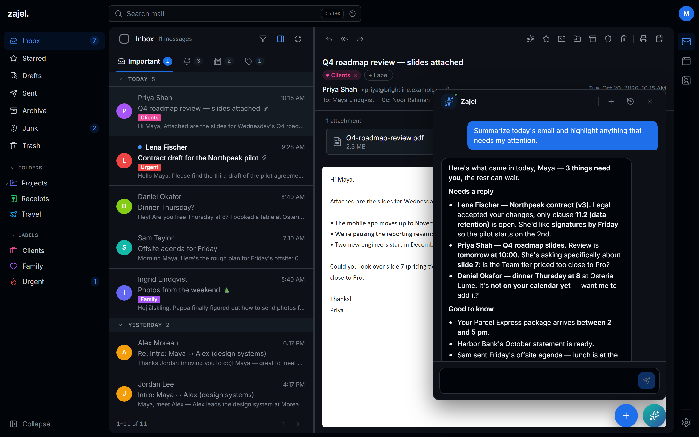

Zajel lives in the corner next to **+**. Ask it anything about your mail or calendar.

- **"Summarize today's mail."** Zajel reads what came in and tells you what needs a reply, what's good to know and what can wait.
- **"What's on tomorrow?"** Zajel walks your calendar and helps you prepare for each meeting.
- **"Summarize this email."** Bullet points, with what's asked of you and by when.
- **"Did the accountant ever send the Q3 figures?"** Zajel doesn't do one fixed search. Each round it picks a tool:
  - search the mail, across every folder, including archived mail
  - open a message to read it in full
  - look at the calendar

  It stops as soon as it can answer.
- **Draft replies** for you to review and send.
- **Calendar proposals.** Zajel proposes events, and even deletions, as cards that name the event and date. Nothing changes until you confirm.
- **Task proposals** go to **Todoist**, **Linear**, **Notion**, a generic **webhook**, or an **MCP-to-HTTP bridge**, again only after you confirm.
- **Persistent conversations** with history. Answers are rendered in Markdown.

Zajel runs on **OpenAI's GPT-5.6** when `OPENAI_API_KEY` is set:
- `gpt-5.6-terra` by default, the balanced tier
- `gpt-5.6-luna` for speed and price

Otherwise it runs on **any Ollama-compatible endpoint**: Ollama Cloud, or a model on your own hardware. Requests to OpenAI are sent with `store: false`, so OpenAI keeps no copy of the mail Zajel was shown.

### Jev: an Inbox that sorts itself

[Jev](https://docs.typesafe.ai) is TypeSafe's decision model. It doesn't write text; it answers typed questions about each email, with probabilities. Zajel Mail uses those answers in three places.

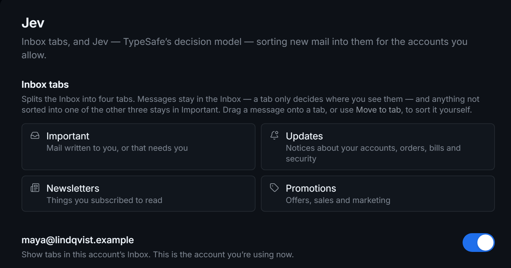

**1. Sorting new mail into tabs.** Each new email is judged **once**, together with facts the app works out:
- whether the sender is a contact
- whether you've written to them
- whether it's a mailing list
- whether it carries a sign-in code

A confident pick is applied. Anything else stays in **Important**, so nothing is hidden because Jev was unsure. The message view shows **why** a message landed where it did.

Jev learns from you:
- **It never moves mail you've put in a tab yourself.**
- **Your moves teach it.** When you move a message, that's passed to Jev with that sender's next email.
- **Pinning** a sender, or a whole `@domain`, to a tab means Jev isn't asked again.

Before switching it on, **Try Jev** shows where it would put your newest 200 Inbox emails, without moving anything. Afterwards, the mail already in your Inbox can be **sorted in the background**, with a cost estimate first.

**2. Rules in plain English.** A rule can have a condition Jev judges, such as *"it's an invoice, a receipt or a request for payment"*. You set a strictness:
- Loose (60%)
- Normal (80%)
- Strict (95%)

Mix these conditions freely with exact matches like *From contains…*, and test the rule on recent mail before you save it. Rules with a Jev condition never delete.

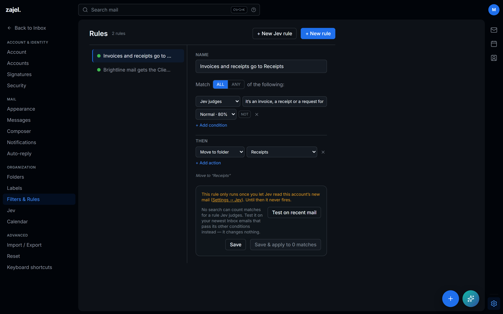

**3. A second opinion on spam and phishing.** Jev runs beside Stalwart's filter, which keeps running.
- **Watch only** records Jev's verdict next to Stalwart's, with a report of where the two disagree. Nothing moves.
- **Active** moves mail Jev is at least 90% sure is spam or phishing to Junk. It warns from 60%, and never moves mail from your contacts or people you've written to. It also brings mail back out of Junk when Jev is very sure it's fine and the sender passed DMARC.

Jev is **off until you turn it on, account by account.** For a demo or development without a key, `JEV_MOCK=1` answers on the server and labels every answer as a mock, so a demo can never be mistaken for Jev. [JEV_PLAN.md](JEV_PLAN.md) has the full design.

### Calendar

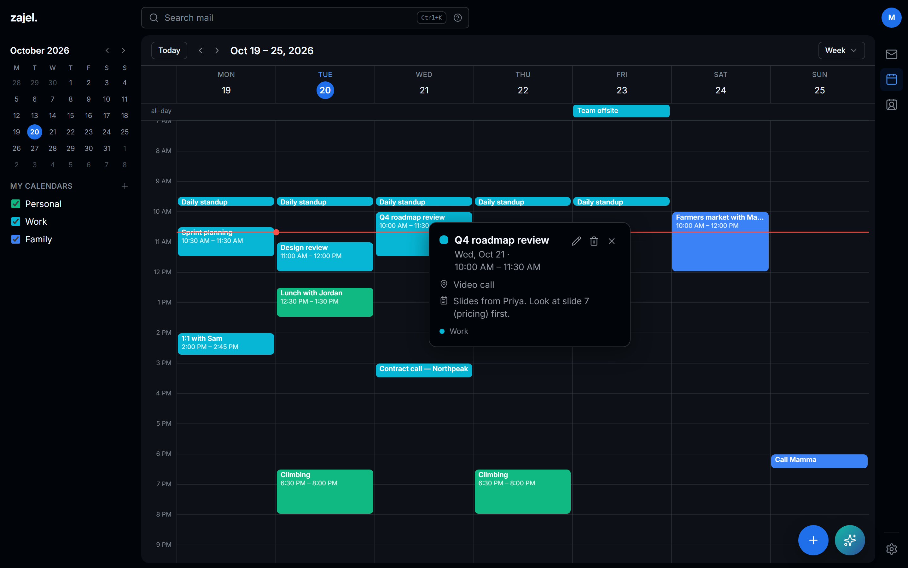

- **Your CalDAV calendars**, discovered automatically (RFC 6764). Calendars on the same Stalwart server work out of the box.
- **Five views**: month, week, work week, 3-day and day. The app remembers the one you last used. There's a mini-month for jumping around, and a line marking the current time.
- **Several calendars**, each with its own colour, that you can show or hide. Create, rename and delete calendars from the sidebar.
- **Events**: create, edit and delete, recurring series included. Changes to a series ask whether you mean this event or all of them.
- **Invitations.** Invites that arrive by email show as an RSVP card in the message, parsed straight from the attached calendar file.
- **Reminders and notifications** for upcoming events, and for events that are new or changed.
- **Keyboard shortcuts**:

  | Key | Action |
  | --- | --- |
  | <kbd>T</kbd> | Today |
  | <kbd>M</kbd> | Month view |
  | <kbd>W</kbd> | Week view |
  | <kbd>F</kbd> | Work week view |
  | <kbd>3</kbd> | 3-day view |
  | <kbd>D</kbd> | Day view |
  | <kbd>C</kbd> | New event |
  | <kbd>←</kbd> <kbd>→</kbd> | Previous / next |

- **Your week, your way.** The week can start on Saturday, Sunday or Monday.

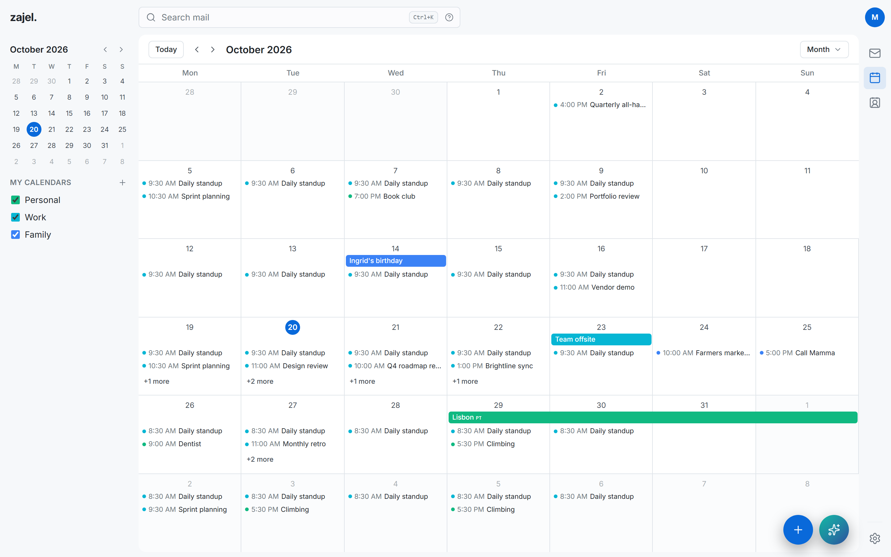

### Contacts

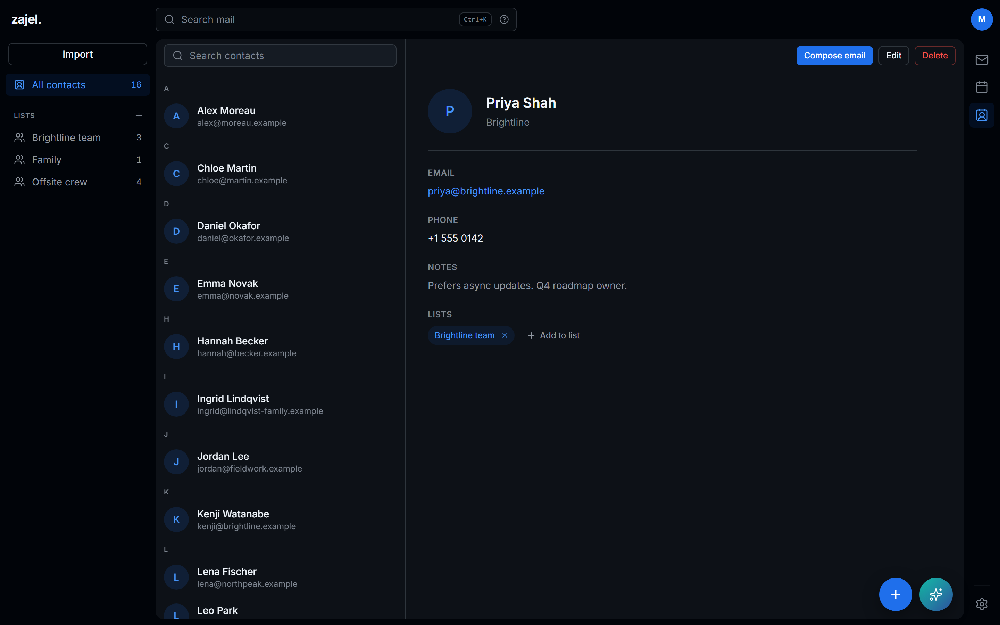

- **Stored in Stalwart over JMAP**, so they stay in sync with your phone and any CardDAV client.
- **Contact lists** (JSContact groups), so you can keep teams, family or an offsite crew together. Add someone to a list straight from their card.
- **Details**: favourites, organisations, phone numbers and notes.
- **Compose email** from any contact.
- **Import** vCard and CSV exports from Apple and Google. A preview shows valid, duplicate and rejected rows before anything is written.
- **Loads with the page.** Contacts arrive server-rendered on a fresh load, stream in when you switch from another page, and are preloaded when you hover the rail.

### Make it yours

<p align="center">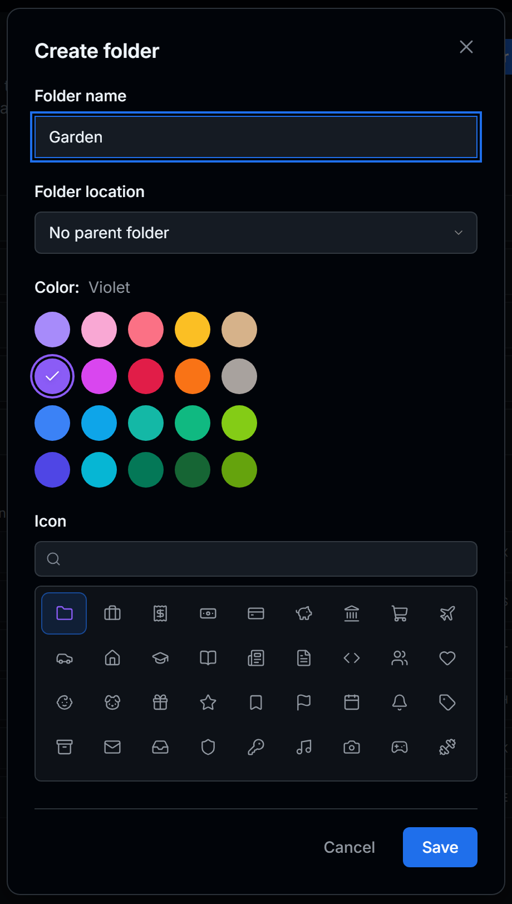</p>

- **Folder and label icons.** Choose from the entire Lucide set, about 1,900 icons, searchable by name and keyword ("money" finds a banknote), with likely picks first. Icons show in the folder's colour everywhere it appears.
- **A palette of colours** for folders, labels, accounts and calendars.
- **Dark or light**, with comfortable or compact density.

  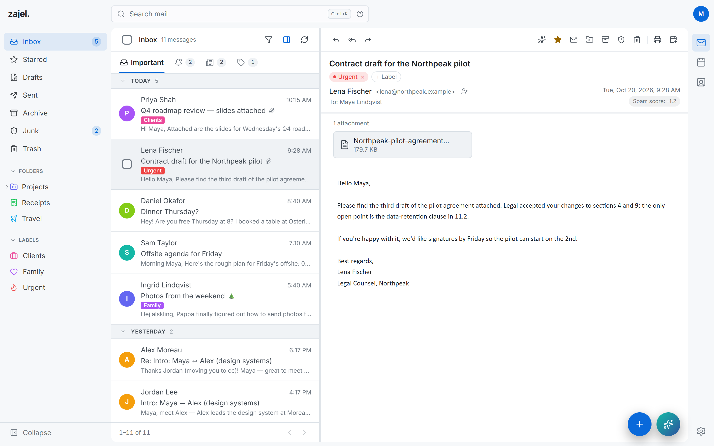

- **Messages**:
  - conversation view on or off
  - default sort: newest, oldest, subject or sender
  - a mark-as-read delay
  - remote-image policy
  - automatic Trash emptying
- **Composer**: default font and size, auto-save interval and Undo send window.
- **Signatures**: as many as you like, with a default for each identity.
- **Notifications** for new mail, plus new and updated events and event reminders.
- **Import / Export** your preferences as a file, or **Reset** them.

### On your phone

<p align="center">
  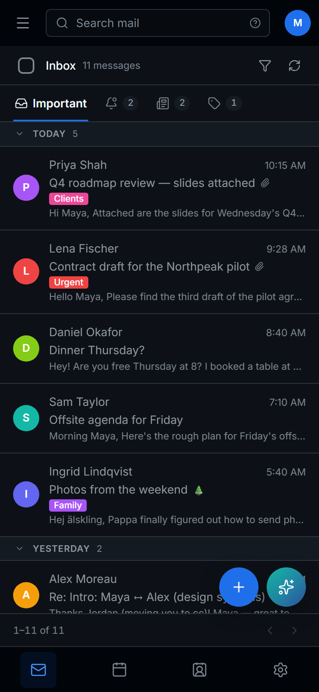
  &nbsp;
  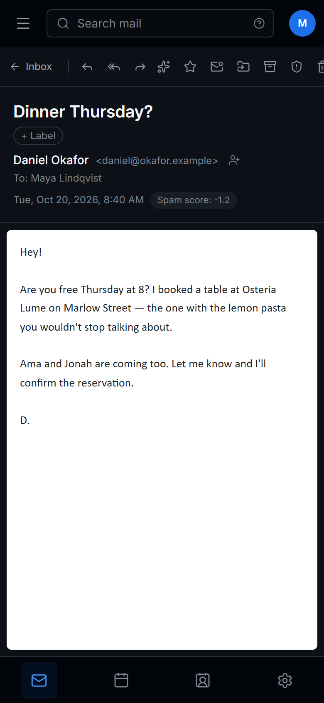
  &nbsp;
  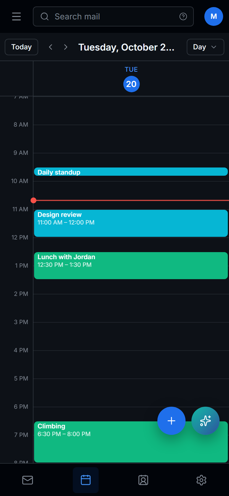
</p>

The same app, laid out for a small screen:
- a bottom tab bar for Mail, Calendar, Contacts and Settings
- folders in a drawer
- full-screen reading
- the **+** and Zajel buttons where your thumb is

It installs as a **Progressive Web App** with its own icon, and shows a friendly offline page when the connection drops.

---

## Security and privacy

Zajel Mail holds the keys to your mail, so security comes first.

**Signing in**
- **One master login** for the app, separate from your mail accounts' passwords. It's hashed with **scrypt** (N=2¹⁷, r=8, p=1).
- **Passkeys** (WebAuthn) for passwordless sign-in.
- **Active sessions** are listed in Settings → Security, where you can sign them out.
- **Brute-force protection.** After 10 failed sign-ins in 15 minutes, sign-in locks for 15 minutes.
- **Session cookies** are `HttpOnly`, `Secure` and `SameSite=Strict`. SvelteKit's origin check (`ORIGIN`) guards every form post.

**Your mail credentials**
- **Linked mail-account passwords are encrypted at rest** with **AES-256-GCM**, using a key derived (HKDF) from `WEBMAIL_SECRET`.
- **Secrets never reach the browser.** AI, Jev and task-app tokens are read only in server-side modules.

**Reading mail safely**
- **Messages render in a sandboxed iframe** with scripts disabled.
- **Remote images go through the server**, so trackers see your server, not your device. You choose when they load at all.
- **Spam and authentication signals** are visible: the spam score, authentication results and sender trust are shown, not hidden.

**AI that asks first**
- **Zajel only proposes.** Replies, events, deletions and tasks wait for your click. The confirmation card names exactly what will happen.

### Where your data goes

- **AI.** Email content goes only to the AI service you configure: OpenAI (sent with `store: false`) or your own Ollama endpoint.
- **Jev.** Mail goes to TypeSafe only for accounts where you switch Jev on.
  - Each new email is sent **once**: sender, recipients, subject, the first 2,000 characters of the body with quoted replies removed, and the facts the app works out about it.
  - Jev returns probabilities. The app keeps those and the facts; it **never stores the email text**.
  - "Try Jev" sends your newest 200 Inbox emails the same way, once, when you press it.
  - TypeSafe states it doesn't train on customer data. Its documentation doesn't state a retention period, and zero data retention is an enterprise option.
- **Remote images.** They're fetched by the server, so the sender's image host sees the server's address rather than yours. It can still tell the message was opened.
- **Tasks.** A task's title, description and due date go to the task app you chose, **only after you confirm**.
- **Calendar changes** go to your own CalDAV server, also only after you confirm.

The task adapter receives a `POST` body only after confirmation:

```json
{
  "source": "ai-jmap-webmail-client",
  "task": {
    "title": "Reply to Sam",
    "description": "Send the requested figures.",
    "dueDate": "2026-08-18"
  }
}
```

A task app API, an automation tool or an MCP-to-HTTP bridge can handle this contract directly.

**Found a vulnerability?** Please report it privately. [SECURITY.md](SECURITY.md) explains how.

---

## Installation

You need a **JMAP mail server**. Zajel Mail is developed and tested against **[Stalwart](https://stalw.art)**, which also serves CalDAV for calendars and JMAP for contacts.

### Quick start (development)

Requires **Node.js 22+**.

```sh
git clone https://github.com/odaiameera/zajel-mail.git
cd zajel-mail
npm ci
cp .env.example .env.local
openssl rand -base64 32
```

Put the generated value in `.env.local` as `WEBMAIL_SECRET`, and set `JMAP_BASE_URL` to your mail server. Then start the app:

```sh
npm run dev
```

Open `http://localhost:5173`. The first-run setup does two things:
1. You create your master login.
2. You link your first mail account. Its password is checked against the server, then stored encrypted.

### Docker (production)

```sh
cp docker-compose.example.yml docker-compose.yml
# fill in ORIGIN, JMAP_BASE_URL and WEBMAIL_SECRET, plus any optional services
docker compose up --build -d
```

The example binds to `127.0.0.1:3001`. Put it behind a TLS reverse proxy (Caddy, nginx or Traefik) for remote access, and set `ORIGIN` to the public URL.

The SQLite database lives at `/data/ameera.db`, so mount a volume there. Back up `WEBMAIL_SECRET` with it: if you rotate the secret, you have to re-enter every linked account's mail password.

### Installing with Jev

Jev is optional and off by default. Here's how to switch it on.

**1. Get a TypeSafe API key.** See [docs.typesafe.ai](https://docs.typesafe.ai/introduction/quickstart).

**2. Add it to the server's environment.** In `.env.local` for development, or the compose `environment:` block for production:

```yaml
environment:
  - TYPESAFE_API_KEY=<your TypeSafe API key>
  # Optional. Defaults to the pinned jev-1.13.0; thresholds are tuned per version.
  # - JEV_MODEL=jev-1.13.0
  # Optional. Route through a gateway such as LiteLLM.
  # - TYPESAFE_BASE_URL=https://gateway.example.com
```

**3. Restart the app**, then open **Settings → Jev**.

**4. Turn on Inbox tabs** for the account. The switch is per account.

**5. Press "Try it"** under *Try Jev on your last 200 emails*. You'll see where each message would go. Nothing is moved.

**6. Switch on "Let Jev read new mail"** for the account. Jev sorts mail that arrives from now on.

**7. Optional: sort what's already there.** *Sort the mail already in your Inbox* runs in the background, after showing a cost estimate.

**8. Optional: spam checks.** Start with **Watch only**, compare Jev's verdicts with Stalwart's in the report, and move to **Active** once you trust it.

**9. Write Jev rules.** In **Settings → Filters & Rules → New Jev rule**:
1. Describe the mail in plain English.
2. Pick a strictness.
3. Press **Test on recent mail**.
4. Save.

**10. Teach it as you go.** Move mail between tabs, and pin senders or `@domains` to a tab.

> **No key yet?** Set `JEV_MOCK=1` to try the whole flow. Answers are worked out on your server from the same facts, nothing is sent to TypeSafe, and every answer is labelled as a mock.

### Setting up Zajel

Zajel is optional too, and hidden until an AI service is configured. Pick one of these.

**OpenAI (GPT-5.6):**

```yaml
environment:
  - OPENAI_API_KEY=<your OpenAI API key>
  # Optional. Defaults to gpt-5.6-terra; gpt-5.6-luna is faster and cheaper.
  # - OPENAI_MODEL=gpt-5.6-luna
```

**Ollama, in the cloud or on your own hardware:**

```yaml
environment:
  - OLLAMA_URL=https://ollama.com        # or http://your-ollama-host:11434
  - OLLAMA_API_KEY=<only if your endpoint needs one>
  - OLLAMA_MODEL=<a tag your endpoint serves>
```

When both are set, OpenAI wins.

`OLLAMA_MODEL` has to name a tag your endpoint actually serves. Ollama Cloud uses `-cloud` tags; a bare library tag resolves only on a self-hosted endpoint that has pulled it. To list what your endpoint offers:

```sh
npm run ai:models
```

It prints every tag, marks the one `OLLAMA_MODEL` is set to, and exits non-zero when that tag is missing, so it can also run as a deployment preflight.

If a model request fails, the server log has an `[ai]` line with the provider's own explanation. That detail is kept out of the browser on purpose.

To let Zajel create tasks, configure any combination of Todoist, Linear, Notion or a generic task adapter (see [Configuration](#configuration)). When more than one is connected, the confirmation card lets you choose.

---

## Configuration

| Variable | Required | Purpose |
| --- | --- | --- |
| `WEBMAIL_SECRET` | Yes | Encrypts linked mail-account passwords at rest. Use a stable random value of at least 32 characters. |
| `JMAP_BASE_URL` | Recommended | Default mail-server URL offered when linking an account. |
| `ORIGIN` | Production | Public URL used by SvelteKit's request-origin checks. |
| `DATABASE_PATH` | No | SQLite path. Defaults to a local development database, or `/data/ameera.db` in production. |
| `OPENAI_API_KEY` | AI only | Runs Zajel and event extraction on OpenAI instead of Ollama. |
| `OPENAI_MODEL` | No | OpenAI model. Defaults to `gpt-5.6-terra`; `gpt-5.6-luna` is faster and cheaper. |
| `OLLAMA_URL` | AI only | Ollama-compatible endpoint. |
| `OLLAMA_API_KEY` | AI only | Bearer token, when the endpoint requires one. |
| `OLLAMA_MODEL` | AI only | Model tag the endpoint serves. Verify with `npm run ai:models`. |
| `TYPESAFE_API_KEY` | Jev only | TypeSafe API key. Jev stays unavailable without it. |
| `JEV_MODEL` | No | Jev model version. Defaults to the pinned `jev-1.13.0`. |
| `TYPESAFE_BASE_URL` | No | Override the TypeSafe endpoint, for example to route through LiteLLM. |
| `JEV_MOCK` | No | Set to `1` to answer locally instead of calling TypeSafe, for demos and development. |
| `TODOIST_API_TOKEN` | Todoist only | Personal API token used to create confirmed tasks. |
| `TODOIST_PROJECT_ID` | No | Destination project; tasks go to the Todoist Inbox when it's unset. |
| `LINEAR_API_KEY` | Linear only | Personal API key used to create confirmed issues. |
| `LINEAR_TEAM_ID` | Linear only | UUID of the destination Linear team. |
| `LINEAR_PROJECT_ID` | No | Destination Linear project UUID. |
| `NOTION_API_TOKEN` | Notion only | Integration token with access to the destination data source. |
| `NOTION_DATA_SOURCE_ID` | Notion only | Data-source ID where confirmed tasks become pages. |
| `NOTION_DUE_PROPERTY` | No | Date-property name. Otherwise `Due`, `Due date` or `Deadline` is detected. |
| `TASK_ADAPTER_URL` | Task creation only | HTTP endpoint that accepts confirmed task proposals. |
| `TASK_ADAPTER_API_KEY` | No | Bearer token for the task adapter endpoint. |

Changing a model is a configuration change, not a code change. Set the variable and restart.

---

## Contributing

Contributions are very welcome: bug fixes, features, docs and design polish all count.

### Getting set up

1. **Fork and clone** the repository, then run `npm ci`.
2. **Copy `.env.example` to `.env.local`** and fill in `WEBMAIL_SECRET` and `JMAP_BASE_URL`.
3. **Use a test mail account.** The dev server talks to whatever JMAP account you link, so a throwaway account on your Stalwart server is the safe choice. It means you can't send, move or delete real mail by accident.
4. **Run `npm run dev`** and open `http://localhost:5173`.

Never commit `.env`, `.env.local`, `docker-compose.yml` or anything from `local-data/`. They hold secrets and personal data.

### Checks

Run these before opening a pull request. CI runs the same three on every push and PR.

```sh
npm run check     # svelte-check + TypeScript
npm test          # Vitest unit and integration tests
npm run build     # production build
```

There are two more checks against real protocol output:
- `npm run test:ics` for ICS parsing
- `npm run test:caldav` for CalDAV discovery

### Where things live

| Path | What's there |
| --- | --- |
| `src/lib/jmap/` | The typed JMAP client: mail, mailboxes, labels, contacts and identities. |
| `src/lib/server/` | Server-only code: auth and crypto, calendar (CalDAV, ICS, iMIP), Zajel (`ai/`), Jev (`jev/`), rules and Sieve, scheduled send, reminders, avatars, SQLite (`db/`). |
| `src/lib/components/` | Svelte 5 components: the mail list and reader, composer, calendar, contacts, Zajel's panel and settings. |
| `src/lib/icons.ts` | The icon registry. Every icon is named by the job it does. |
| `src/routes/(app)/` | The app's pages: inbox, folders, search, calendar, contacts and settings. |
| `src/routes/api/` | JSON endpoints the pages call. |
| `src/lib/server/db/migrations/` | Numbered SQL migrations. They run automatically at startup. |

### How we work

- **One focused change per pull request**, on its own branch off `main`. Keep design and UI polish in a separate PR from feature or logic changes, so each can be reviewed on its own terms.
- **Write commit messages that explain why**, not only what changed.
- **Add tests** for server logic, JMAP calls and anything with edge cases. Vitest and Testing Library are set up.
- **Follow the stack's idioms**: Svelte 5 runes (`$state`, `$derived`, `$effect`), Tailwind v4 utilities with the theme's CSS variables, and TypeScript throughout.
- **Use icons from the registry.** Go through `<Icon name="…" />` and `$lib/icons`, so a job never gets a second drawing and a drawing never takes on a second meaning.
- **Keep UI copy short.** Use labels and short titles. Don't add hint sentences, example placeholders or tags like "(default)". People know how to use mail.
- **Keep secrets on the server.** Anything that reads a token belongs in `src/lib/server/`.
- **Make the assistant propose, never act.** New Zajel abilities that change data must surface as a confirmation card.

### Reporting problems

Open an issue with steps to reproduce, what you expected and what happened. For **security issues, don't open a public issue**: use GitHub's private vulnerability reporting, as described in [SECURITY.md](SECURITY.md). Never include real credentials, API keys, private messages or database files in a report.

---

## Roadmap

This started as a mail client and is growing into a full personal workspace: a small set of well-integrated apps that share context, rather than a large set of shallow ones.

**Next: Tasks and Notes.** Tasks is already stubbed in the app rail. Tasks and Notes will both be backed by a **dedicated local SQLite store, independent of Stalwart**. Mail, calendar and contacts belong to the mail server; personal notes and tasks don't, and forcing them through a mail protocol would constrain the data model for no benefit.
- **Tasks** becomes a first-class app, so Zajel's task proposals can land in the product. External adapters stay for people who live in Todoist or Linear.
- **Notes** are durable and searchable, and can be linked to mail threads, events and contacts.

**Then: broader server support.** JMAP is the right protocol, but most mail still lives behind IMAP.
- **IMAP**, and **POP3** for accounts that only offer it, would let Zajel Mail front Dovecot, Cyrus or a provider with no JMAP endpoint.
- The mail layer already sits behind a typed client boundary, so this means adding a backend, not a rewrite.

**Then: a shared canvas.** With Notes and Tasks in place, Zajel can work across all five apps:
- turn a thread into a task with the message attached
- pull meeting notes into an event
- answer questions that span mail and notes

**Also planned**
- **Contacts**: contact photos, vCard export, and merging duplicates already in the address book.
- **Composer**: saved contacts and a server-side index of previous recipients in the autocomplete, with contacts ranked first.
- **Keyboard shortcuts**: a full reference page, and more shortcuts in Mail.
- **Packaging**: a published container image, so deploying is just `docker compose up`.

Nothing here has a date on it. This is a personal project built in the open, and the roadmap describes intent, not a commitment.

---

## License

[MIT](LICENSE)
